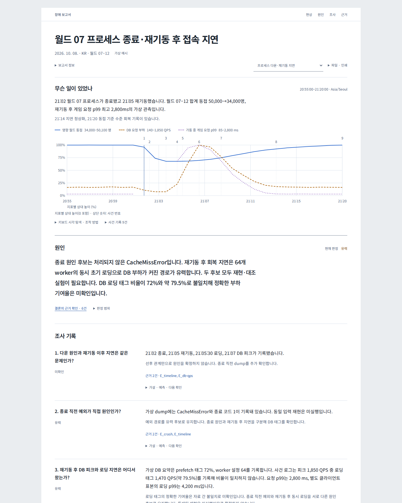
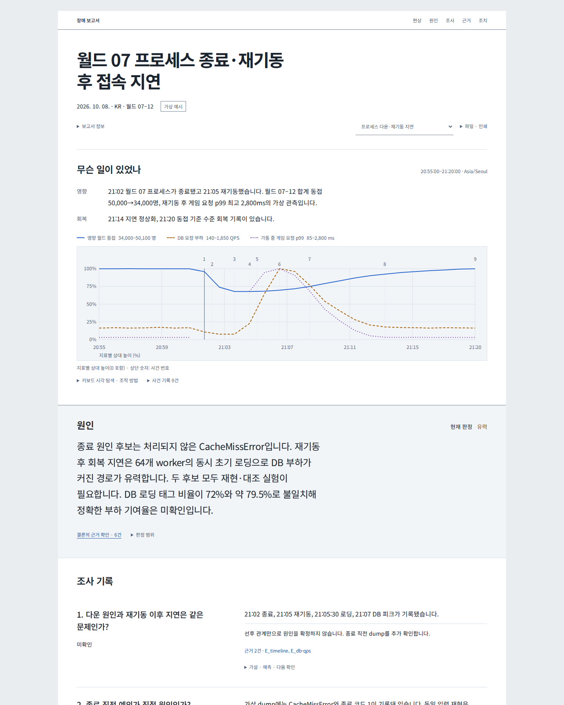
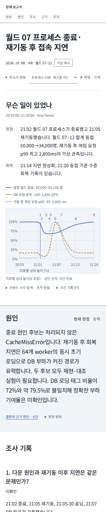
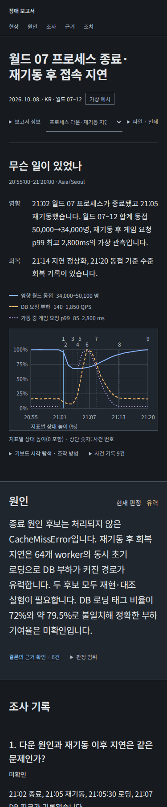

# 장애 보고서 시각 계층 재구성

검토 기준은 `jungrok5/report`의 main 커밋 `914e2999b25eb14a0396fd9bdb94cc3db1f02376`입니다. ai-design 최신 main `f4811d6e0d085c381dad02e769caea38b5759cda`의 1.4.0 글·UI 스킬과 공통 기준을 읽었습니다. UI 스킬과 공통 기준은 보고서에 고정된 1.2.0 적용본과 동일합니다. 최신 글 기준의 반복 제목·도입부 관련 보완도 확인했습니다. 이번 변경은 보고서의 내용과 순서를 보존하는 화면 수정이므로 기존 문장은 수정하지 않았습니다.

현재 사이트의 목적은 장애 현상, 영향, 원인 후보와 판정, 조사 근거, 조치를 구분해서 확인하는 것입니다. 이전 버전은 카드 장식을 줄였지만 제목·원인·조사 기록의 크기 차이가 작고, 영향과 회복은 라벨 없는 문단으로 이어졌습니다. 기존 화면과 변경 화면을 같은 보고서와 글꼴로 렌더링해 비교했습니다.

| 영역 | 적용 이유와 구현 |
| --- | --- |
| 이슈 제목 | 제목 28–44px, 한글 줄바꿈,  본문과 구분되는 여백. 제목에만 큰 크기와 강한 굵기 사용 |
| 현상·영향·회복 | 영향과 회복을 `dl`로 구분. 원래 문장과 표시 순서 유지 |
| 공통 시간축 | 중립 관측 배경과 테두리. 실제 수치·단위·선 모양·표본·조작 방식 유지 |
| 원인 | 페이지 폭의 중립 배경, 24px 요약 문단. 현재 판정은 색과 상태 글자로 표시 |
| 조사 기록 | 데스크톱에서는 질문과 관측·판정의 두 열. 모바일에서는 질문부터 순차 표시 |
| 분석·근거 | 탭은 밑줄로 선택 상태 표시. 근거 상세는 관측 배경·테두리로 본문과 구분 |
| 조치 | 조치 제목과 담당·기한·상태를 나란히 배치. 모바일에서는 순서대로 표시. 목차의 조치 링크로 숨겨진 탭을 열고 이동 |

## 화면 비교

동일한 가상 보고서를 같은 Noto Sans KR 글꼴로 캡처했습니다. 모바일 브라우저의 실제 시스템 글꼴에 따라 줄바꿈은 달라질 수 있습니다.

| 변경 전 · 데스크톱 | 변경 후 · 데스크톱 |
| --- | --- |
|  |  |

| 변경 후 · 모바일 | 변경 후 · 모바일 다크 |
| --- | --- |
|  |  |

## 변경 파일

| 파일 | 역할 |
| --- | --- |
| `web/src/main.jsx` | 공유 스타일 연결, 조치 목차와 반복 이동, 조치 메타데이터 배치 |
| `web/src/Timeline.jsx` | 영향·회복 정의 목록 |
| `skills/investigate-game-incident/assets/report-tokens.css` | 제목·소제목·원인 본문 크기와 폭 토큰 |
| `skills/investigate-game-incident/assets/report-hierarchy.css` | React·독립 HTML 공용 레이아웃과 시각 계층. 보고서 내부로 선택자 범위 제한 |
| `skills/investigate-game-incident/assets/report-template.html` | 독립 HTML의 같은 의미 구조와 조치 이동 |
| `skills/investigate-game-incident/scripts/render_report.py` | 독립 HTML에 공유 스타일 포함 |
| `skills/investigate-game-incident/assets/DESIGN.md` | 후속 작업에 사용할 화면 기준 |
| `tools/check_style.py` | 공유 스타일을 기존 검사 대상에 포함 |
| `tests/design-browser.cjs` | 원인 본문 대비를 실제 원인 배경에서 검사 |
| `tests/react-browser.cjs` | 조치 목차의 숨겨진 탭 표시와 반복 방문 확인 |
| `docs/index.html`, `docs/investigation.html`, `examples/restart-recovery.html`, `examples/investigation.html` | 원본 자료를 사용해 재생성한 독립 HTML |

## 보존과 검증

이슈 제목 → 무슨 일이 있었나·공통 시간축 → 원인 → 조사 기록 → 분석·근거·조치 순서를 보존했습니다. 네 HTML의 내장 보고서 JSON을 변경 전과 비교해 일치를 확인했습니다. 원본 JSON, 보고서 Markdown, 사례·근거 자료, 수치·시각·단위·조회 URL·해시·판정·검토·버전 기록에는 변경이 없습니다.

스타일 검사 0 오류·0 경고, 빌드, Python 43개·모델 7개 검사를 통과했습니다. 재생 보고서·세 사례의 보존본 바이트 비교도 통과했습니다. Chromium에서 React 세 사례의 1100·390·320px 조작·근거·해시·import·검토·인쇄와 독립 HTML·조사 엔진의 1024·390·320px 조작을 확인했습니다. 라이트·다크의 375·768·1024·1440px 가로 넘침·원인 대비와 인쇄 대비도 검사했습니다. 전후 화면과 새 조치 화면은 375·1440px에서 Noto Sans KR로 직접 검토했습니다.

현재 예시는 합성 자료입니다. 화면·기능 검증 결과가 실제 운영 장애의 인과관계나 독자의 이해도를 증명하지 않습니다. 검토용 브랜치의 변경이며 main 병합과 운영 페이지 배포는 포함하지 않습니다.
